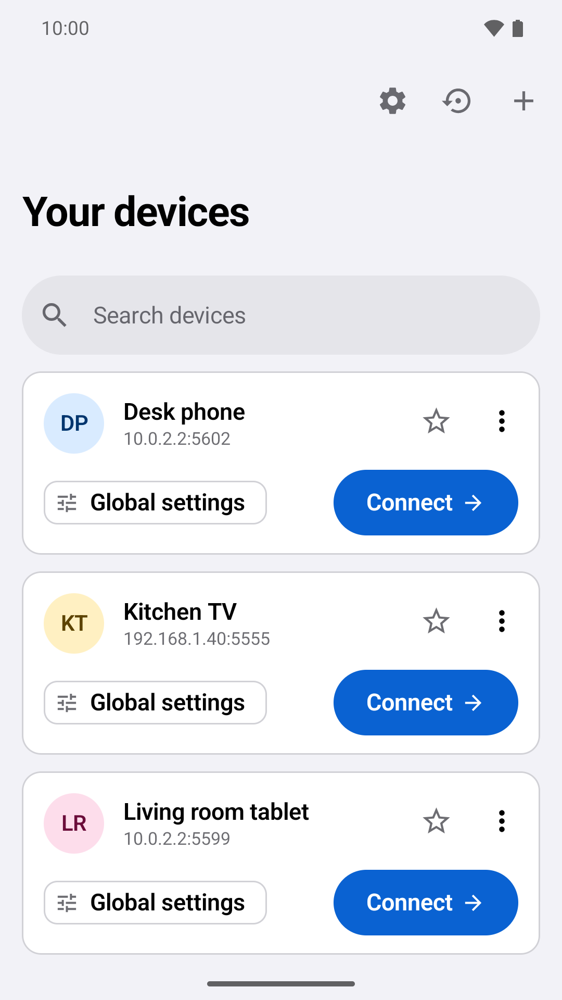
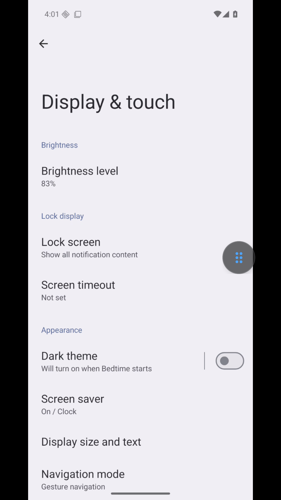
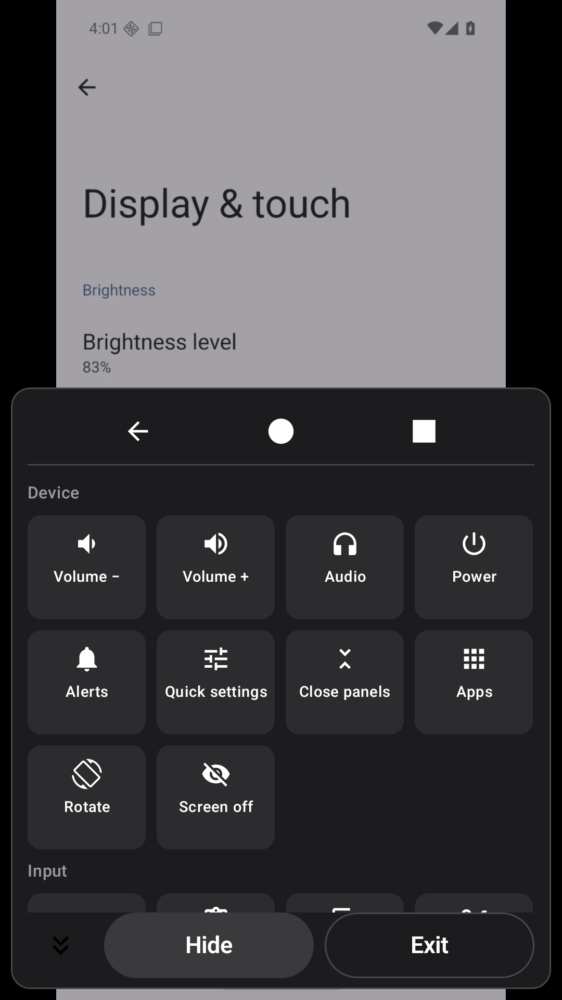
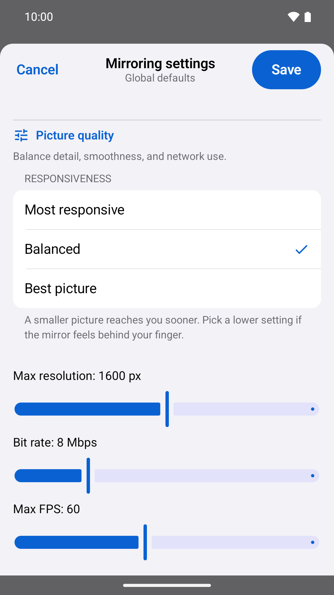

# Scrcpy Android

An open-source Android client for low-latency screen mirroring, audio streaming, remote input, file transfer, and app management on another Android device over ADB/TCP and Android 11+ Wireless Debugging.

Powered by the official unmodified [scrcpy](https://github.com/Genymobile/scrcpy) **5.0.1** server, Android `MediaCodec`, Jetpack Compose, and a hardened local `:libadb` transport stack (TLS 1.3 + BoringSSL-derived SPAKE2 pairing).

- **Current version:** `3.5.7` (`versionCode` 86)
- **Minimum Android version (controller):** Android 8.0 (API 26)
- **Target / compile SDK:** Android 16 (API 36), 16 KB page-size aligned
- **License:** [Apache-2.0](LICENSE)

> **Disclaimer:** Scrcpy Android is an independent open-source client for `scrcpy` and is not affiliated with, endorsed by, or sponsored by Genymobile, Romain Vimont, or Google LLC. Android is a trademark of Google LLC.

## Screenshots

<p align="center">
  
  
  
  
</p>

## Highlights

- **Wireless Debugging & ADB/TCP:** Built-in six-digit **SPAKE2 pairing** and TLS 1.3 connection support for Android 11+, automatic mDNS (`_adb-tls-connect._tcp`) port discovery when wireless debugging ports rotate, plus legacy TCP (`5555`) support on trusted local networks.
- **Low-Latency Video & Picture-in-Picture:** Hardware `MediaCodec` decoding (`H.264`, `H.265`, `AV1`, `VP8`, `VP9`), unbuffered gesture dispatch, local up-to-8x magnification & two-finger pan, camera viewfinder mirroring with **Picture-in-Picture (PiP)**, virtual displays, and **Adaptive Desktop** (`flex_display` + live resize).
- **Full Audio Pipeline (11 Sources):** `Opus`, `AAC`, `FLAC`, and raw `PCM` audio with selectable capture sources (`device`, `playback` with optional on-device duplication on Android 14+, `mic` presets, and call sources where permitted), optional background audio playback, and opt-in audio/video presentation-clock synchronization.
- **Mid-Session Switching (`Picture & sound`):** Switch video codec, audio codec, or audio source on the fly with one reconnect and automatic rollback if a target encoder rejects the new configuration.
- **Input Modes:** Direct multi-touch, **Precision Pad** (virtual trackpad pointer with tap, drag-lock, two-finger scroll, and speed steps for small targets), **Live Keyboard** (real-time IME synchronization including Hangul/CJK composition, navigation/editing key row, plus Draft mode), physical keyboard/mouse forwarding, bidirectional clipboard sync, and **Input Lock** for view-only sessions.
- **Screenshots & MP4 Recording with Sound:** Lossless packet-muxed MP4 screen recording (with synchronized AAC audio) and surface `PixelCopy` PNG screenshots, saved via Android's Storage Access Framework or shared directly through a narrowly scoped `FileProvider`.
- **File Push & APK / Split-Bundle Installer:** Stream files to the remote `Download` folder with collision-safe naming and cancellation, or install single `.apk` packages and split bundles (`.apks`, `.xapk`, `.apkm`, split-APK `.zip`) matched to the target device's ABI, screen density, SDK, and locales via `pm install-create` sessions.
- **Diagnostics & Connection Health:** Step-by-step connection checkup with per-stage timing, per-device connection failure history, live FPS / bitrate / socket-to-surface p50 & p95 client latency telemetry, and 60-second quality trend sparklines.
- **Portable Backups & Deep Links:** Versioned JSON profile export/import with conflict previews and 5-snapshot local rollback history, home-screen pinned shortcuts, and validated `scrcpy://` connection links.

## Documentation

- [Documentation Index](docs/README.md)
- [Changelog](CHANGELOG.md)
- [scrcpy 5.0.1 Server Features & Option Mapping](docs/SCRCPY_FEATURES.md)
- [Privacy Policy](app/src/main/assets/legal/privacy-policy.md) ([HTML](docs/privacy-policy.html))
- [Third-Party Software Notices](THIRD_PARTY_NOTICES.md) & [Third-Party Sources](third_party/README.md)
- [Contributing](CONTRIBUTING.md) · [Security Policy](SECURITY.md) · [License](LICENSE)

---

## Connecting to a Device

Only connect to devices you own or are explicitly authorized to control on a trusted local network. When using remote microphone or call-audio sources (`mic*`, `voice-call*`) or MP4 audio recording, you are responsible for complying with all applicable privacy, wiretapping, and all-party consent laws.

### Android 11+ Wireless Debugging (Recommended, Encrypted)

1. On the target Android device, enable **Developer options** and **Wireless debugging**.
2. Tap **Pair device with pairing code** on the target device.
3. In Scrcpy Android, tap **Pair new device** and enter the target's IP address, **pairing port**, and six-digit pairing code.
4. Add the device using the main **connection port** shown on the target's Wireless debugging screen.

When Wireless debugging is toggled off and back on, Android assigns a new connection port. For saved non-`5555` endpoints, Scrcpy Android queries `_adb-tls-connect._tcp` over mDNS during reconnect/retry and adopts a replacement port only when a single unambiguous numeric IP matches the saved host.

### Legacy ADB over TCP (Port 5555)

For Android 8–10 targets (or devices configured over USB):

```bash
adb tcpip 5555
```

Connect to `<device-ip>:5555` and accept the **Allow USB debugging** prompt on the target screen. Legacy ADB over TCP is **not encrypted** — use it only on trusted private networks and never expose port `5555` to the internet.

### Connection Links (`scrcpy://`)

`scrcpy://` links open directly into a confirmation dialog before connecting, never modifying stored device profiles:

```text
scrcpy://192.168.1.20:5555
scrcpy://connect?host=192.168.1.20&port=5555&name=Desk%20phone&preset=responsive&codec=h265
```

Supported query parameters:

| Parameter | Accepted values | Description |
|---|---|---|
| `preset` | `responsive`, `balanced`, `quality` | Sets resolution, video bitrate, and FPS together |
| `maxSize` | `640`–`2560` | Maximum video edge in pixels |
| `bitrate` | `1`–`30` | Video bitrate in Mbps |
| `fps` | `15`–`120` | Maximum frame rate |
| `codec` | `h264`, `h265`, `av1`, `vp8`, `vp9` | Video codec for the session |
| `orientation` | `follow`, `current`, `0`, `90`, `180`, `270` | Capture orientation lock |
| `displayId` | `0`–`4096` | Target display ID to mirror |
| `audio` | `device`, `playback`, `mic`, `mic-unprocessed`, `mic-camcorder`, `mic-voice-recognition`, `mic-voice-communication`, `voice-performance`, `voice-call`, `voice-call-uplink`, `voice-call-downlink`, `off` | Audio capture source or disabled audio |
| `audioCodec` | `opus`, `aac`, `flac`, `raw` | Audio codec for the session |
| `audioBitrate` | `16`–`320` | Audio bitrate in kbps (cannot combine with `audio=off`) |
| `audioDup` | `true`, `false` | Keep audio playing on target device (`audio=playback` on Android 14+) |
| `screenOff` | `true`, `false` | Blank target physical screen while mirroring |
| `stayAwake` | `true`, `false` | Keep target awake while charging |
| `keepActive` | `true`, `false` | Periodically signal user activity without changing system settings |
| `showTouches` | `true`, `false` | Show touch indicators on target screen |
| `server` | `5.0.1` (legacy `4.1` / `5.0` tokens migrate to `5.0.1`) | Compatibility server parameter |

Unknown, duplicate, out-of-range, or conflicting parameters reject the entire link rather than silently ignoring fields.

---

## Architecture Overview

```text
app/src/main/java/com/scrcpy/remote/
├── adb/        # ADB/TLS connection management, sync: file push, mDNS port discovery, RSA/X.509 identity
├── data/       # Saved devices, per-device & global settings codecs, versioned backups, rollback snapshots
├── scrcpy/     # scrcpy 5.0.1 options, stream framing, control/device messages, app/camera/display/encoder parsers
├── session/    # MirrorViewModel, MediaCodec video/audio pumps, PCM playback, MP4 muxer, APK/bundle installer
└── ui/         # Jetpack Compose screens, floating controls, precision pad, live keyboard, legal & diagnostic views

third_party/libadb/
└── src/main/java/io/github/muntashirakon/adb/
                # Locally maintained libadb 3.1.1 with per-packet flow control, AdbTrustManager & Java Spake2
```

### Reliability & Security Design

- **ADB Identity Preservation:** Read errors (disk full or transient I/O failure) never overwrite existing ADB RSA keypairs. Corrupt keys or mismatched key/certificate pairs are atomically regenerated and verified by modulus.
- **Strict TLS & SPAKE2 Pairing:** Wireless debugging connections use `Spake2.java` (ported from BoringSSL under Apache-2.0) and `AdbTrustManager`, accepting only self-signed ADB certificates that verify the TLS handshake.
- **Bounded Backpressure:** Video (`4 MiB` packet cap, `8 MiB` ownership budget) and audio (`256 KiB` packet cap, `512 KiB` ownership budget) use pooled buffers and consumer-driven ADB packet acknowledgements (`2 MiB` peer-credit ceiling) so stalled decoders or networks cannot exhaust heap memory.
- **Input Safety:** Coalesced per-pointer move queues preserve all down/up/key/scroll transitions in order, release held pointers and keys on disconnect/focus-loss/rotation/lock, and enforce `SessionInputGate` boundaries when Input Lock is active.
- **Foreground Lifecycle:** Active sessions hold an Android `connectedDevice` foreground service (`mediaPlayback` when background audio is active; `dataSync` during active file transfers with Android 15 timeout handling).
- **Bundled Server Verification:** Only official unmodified `scrcpy-server-v5.0.1` is packaged (`SHA-256: 764eb6f79811d5211fe9df341120882ba9994c7a61b897d7bf3fb662e53bc536`, `733,930` bytes). Both the APK asset and the remote copy on `/data/local/tmp/` are verified by SHA-256 before execution, and `BundledServerTest` pins the binary digest, size, and embedded version string.

---

## Building & Testing

### Prerequisites

- **JDK 17**
- **Android SDK 36** (`platforms;android-36`, `build-tools;36.0.0`, `platform-tools`)

The checked-in Gradle wrapper pins **Gradle 8.14.5** (with SHA-256 verification) and **Android Gradle Plugin 8.13.2**.

### Build & Unit Test Commands

On macOS / Linux:

```bash
chmod +x gradlew
./gradlew :app:testDebugUnitTest :libadb:testDebugUnitTest :app:lintDebug :app:assembleDebug
./gradlew :app:assembleLocalRelease
```

On Windows PowerShell:

```powershell
.\gradlew.bat :app:testDebugUnitTest :libadb:testDebugUnitTest :app:lintDebug :app:assembleDebug
.\gradlew.bat :app:assembleLocalRelease
```

### Build Variants

- **`debug`** (`app/build/outputs/apk/debug/app-debug.apk`): Universal debuggable APK signed with the local Android debug keystore.
- **`localRelease`** (`app/build/outputs/apk/localRelease/app-localRelease.apk`): R8-minified, resource-shrunk sideload APK signed with the local debug keystore for testing optimized builds without production signing keys.
- **`release`** (`:app:bundleRelease` / `:app:assembleRelease`): Production-signed build. Refuses to run unless signing credentials (`keystore.properties` or `SCRCPY_*` env vars) and public publisher metadata (`publisher.properties`) are configured.
- **Optional per-ABI splits:** Pass `-PabiSplits=true` to emit per-ABI (`arm64-v8a`, `armeabi-v7a`, `x86`, `x86_64`) APKs alongside the universal APK.

### Release Signing Configuration (Optional)

Copy `keystore.properties.example` to gitignored `keystore.properties` (or set `SCRCPY_KEYSTORE`, `SCRCPY_KEYSTORE_PASSWORD`, `SCRCPY_KEY_ALIAS`, `SCRCPY_KEY_PASSWORD`):

```properties
storeFile=release.jks
storePassword=YOUR_STORE_PASSWORD
keyAlias=YOUR_KEY_ALIAS
keyPassword=YOUR_KEY_PASSWORD
```

### Instrumented Android Tests

With an Android 8.0+ (API 26–36) emulator or authorized test device connected:

```bash
./gradlew :app:connectedDebugAndroidTest
```

### Continuous Integration

[`.github/workflows/build.yml`](.github/workflows/build.yml) runs `:app:testDebugUnitTest`, `:libadb:testDebugUnitTest`, `:app:lintDebug`, `:app:lintLocalRelease`, `:app:assembleDebug`, `:app:assembleLocalRelease`, `:app:assembleDebugAndroidTest`, `:app:publicationRuntimeInventory`, and APK signature/badging checks on every push and pull request. An optional API 26 / API 36 emulator instrumentation and upgrade smoke matrix is available via manual `workflow_dispatch` (`run_device_tests: true`).

---

## Privacy & Open-Source Licenses

- **Zero Telemetry:** Scrcpy Android has no user accounts, analytics, crash-reporting SDKs, or ad networks. All screen, audio, input, clipboard, and file traffic flows directly between your controller device and the target device over your local connection.
- **Project License:** Original code in this repository is licensed under the [Apache License 2.0](LICENSE).
- **Third-Party Components:** Every bundled and runtime dependency is permissively licensed (`Apache-2.0`, `MIT`, `BSD-3-Clause`) and listed both in-app (**Settings -> App info -> Open-source licenses**) and in [THIRD_PARTY_NOTICES.md](THIRD_PARTY_NOTICES.md).
